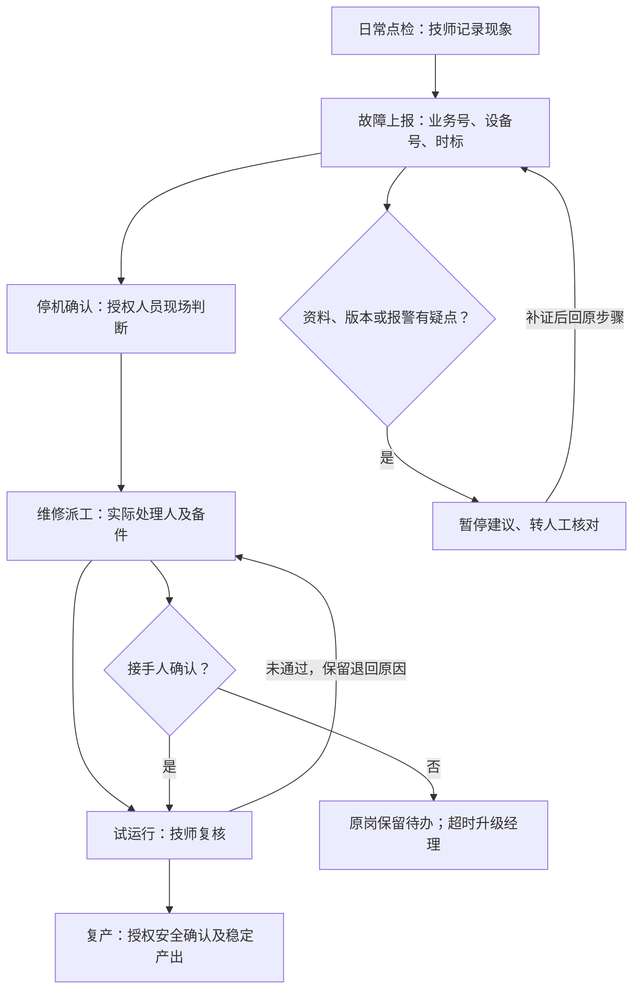

# 现状流程图

依据访谈 f01/f20/f23/f25/f40/f53。此图为访谈还原，非现场实测。具体 SLA、授权人员与业务样本待核。

交接五字段：业务编号、当前版本、处理状态、未解决事项、接手人。发出消息不等于接手确认。

瓶颈：检索历史经验平均 30 分钟（访谈口径）、群消息与便签不随单、跨系统状态分散、修好到稳定复产的确认空档。设备修好时间与稳定复产时间应独立记录。

接口中断时保留带时标只读快照并显示“暂未更新”，原人工流程继续；重连去重补齐。AI 仅核对/草稿，不执行维修、解除保护或放行复产。
